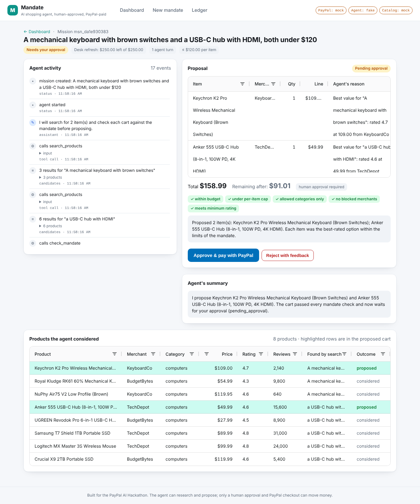
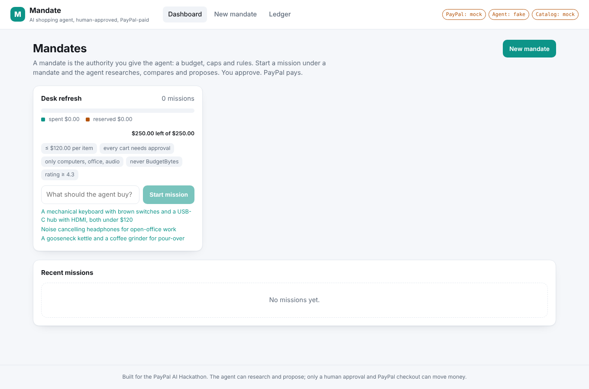
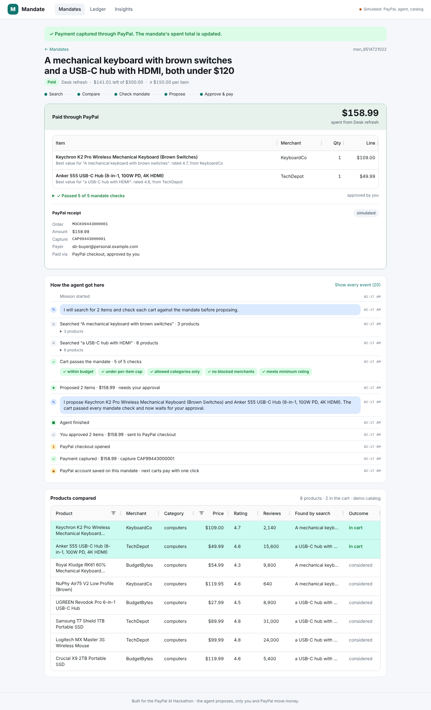
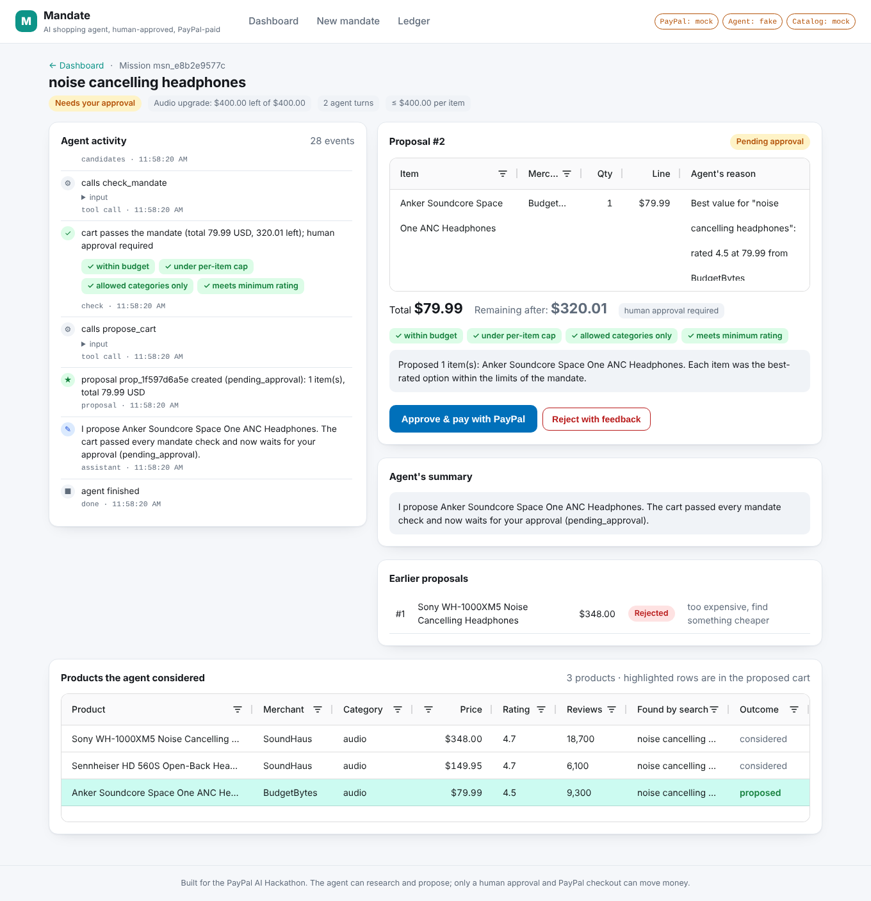
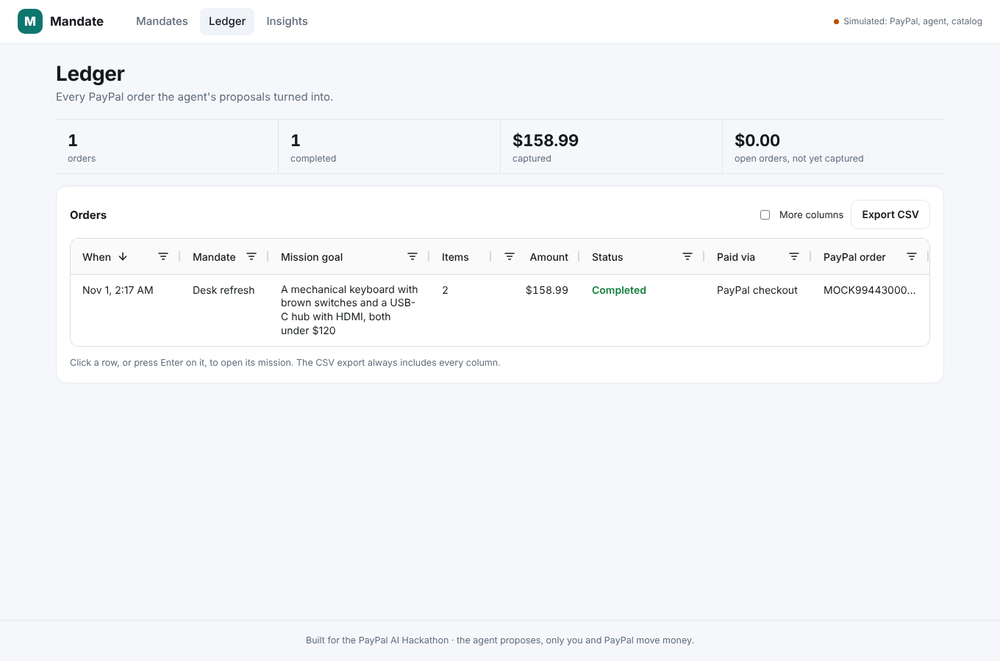

# Mandate

**An AI shopping agent that can only spend inside the mandate you give it, and pays with PayPal.**

You give the agent a *mandate*: a budget, a per-item cap, allowed categories, blocked merchants, a minimum rating and an approval threshold. You give it a *mission*: "a mechanical keyboard with brown switches and a USB-C hub with HDMI, both under $120". The agent researches the catalog, compares candidates, checks every cart against the mandate, and proposes. Nothing moves until a human approves the proposal and completes PayPal checkout. Every order lands in an auditable ledger.

Built for the [PayPal AI Hackathon](https://paypalaihackathon.devpost.com/) (October–November 2026) with Go, Claude, PayPal Orders v2, AG Grid, Channel3 and Render.



## Why

Agentic commerce only works if people can delegate purchases without handing an AI their wallet. Today the choice is binary: either the agent has your payment credentials, or you do every checkout yourself. Mandate adds the missing layer: **a spending authority the agent cannot exceed, enforced in code, plus a human approval gate before every PayPal payment.** The agent is good at research and comparison; the mandate is good at saying no.

## How it works

1. **Create a mandate.** Budget, per-item cap, auto-approve threshold, allowed categories, blocked merchants, minimum rating. The policy engine (`internal/mandate`) is the only thing that decides whether a cart is acceptable.
2. **Start a mission.** A goal in plain language. The agent (Claude via the official Go SDK, `internal/agent`) gets exactly four tools: `search_products`, `get_product`, `check_mandate`, `propose_cart`. It cannot call PayPal.
3. **Watch it work.** Every search, check and decision streams to the UI over server-sent events. The products it considered are shown in an AG Grid, with the proposed ones highlighted.
4. **Approve or reject.** A proposal shows each item, the agent's reason, the total, the remaining budget and which mandate checks passed. Reject with feedback ("too expensive, stay under $80") and the agent revises in the same conversation.
5. **Pay with PayPal.** Approval creates a PayPal order (Orders v2, `intent=CAPTURE`) for the exact cart, reserves the budget, and sends the buyer to PayPal checkout. On return the order is captured and the mandate's spent total is updated. Cancelling at PayPal releases the reservation.
6. **Audit.** The ledger lists every order with mission, mandate, amount, status, PayPal order ID, capture ID and payer, sortable and filterable.

Two independent gates protect the money: the policy engine (re-run at approval time, because the budget may have moved) and PayPal checkout itself, where the buyer logs in and approves. Carts under the auto-approve threshold skip the first gate but never the second.

## Screenshots

| | |
|---|---|
|  Mandates with live budget bars and one-line missions |  Captured payment with PayPal order and capture IDs |
|  Rejected with feedback, revised by the agent |  Ledger across all mandates (AG Grid) |

Dark mode is supported throughout ([screenshot](docs/screenshots/dashboard-dark.png)).

## Quick start

Requirements: Go 1.25+, Node 22+. Nothing else is required for the offline demo.

```bash
git clone https://github.com/sadrax4/mandate && cd mandate
cd web && npm install && npm run build && cd ..   # builds the UI into web/dist (works on Windows, macOS, Linux)
go run ./cmd/mandate                               # http://localhost:8080
```

With no keys configured the app runs in **offline demo mode**: a scripted agent, the built-in demo catalog and a simulated PayPal checkout page. Click *Create demo mandate*, pick a suggested goal, approve, "pay", and look at the ledger. The whole flow takes about a minute and needs no accounts.

### Real mode (PayPal sandbox + Claude)

```bash
cp .env.example .env
# fill in PAYPAL_CLIENT_ID / PAYPAL_CLIENT_SECRET (sandbox app from https://developer.paypal.com/dashboard/)
# and ANTHROPIC_API_KEY (https://console.anthropic.com/)
go run ./cmd/mandate
```

Approving a proposal now creates a real sandbox order. At checkout, log in with a **sandbox personal (buyer) account** from the PayPal Developer Dashboard (*Testing Tools → Sandbox Accounts*), approve, and you are redirected back; the server captures the order and the capture ID appears on the mission page and in the ledger.

To test against a real product catalog, add `CHANNEL3_API_KEY` (free tier at [trychannel3.com](https://trychannel3.com)); the agent then searches live US retail products through Channel3's product search API instead of the demo catalog.

### Configuration

| Variable | Default | Meaning |
|---|---|---|
| `PAYPAL_MODE` | `sandbox` if a client ID is set, else `mock` | `sandbox`, `live` or `mock` (built-in checkout simulator) |
| `PAYPAL_CLIENT_ID`, `PAYPAL_CLIENT_SECRET` | | REST app credentials |
| `PAYPAL_WEBHOOK_ID` | | Optional webhook ID; enables signature verification for `/paypal/webhook` |
| `LLM_PROVIDER` | `anthropic` if a key is set, else `fake` | `anthropic` or `fake` (scripted agent for tests and demos) |
| `ANTHROPIC_API_KEY` | | Claude API key from the Anthropic Console |
| `ANTHROPIC_BASE_URL`, `ANTHROPIC_AUTH_TOKEN` | | Optional: an Anthropic-compatible gateway and bearer token, e.g. `https://openrouter.ai/api` with an OpenRouter key and `ANTHROPIC_MODEL=anthropic/claude-opus-5.5`. Anthropic-only extras (refusal fallback, effort) are skipped automatically |
| `ANTHROPIC_MODEL` | `claude-opus-5-5` | Any current Claude model ID |
| `ANTHROPIC_EFFORT` | `high` | `low`…`max`, controls reasoning depth |
| `CATALOG` | `channel3` if a key is set, else `mock` | `mock` or `channel3` |
| `CHANNEL3_API_KEY` | | Channel3 product search key |
| `PORT` | `8080` | HTTP port |
| `PUBLIC_URL` | `http://localhost:PORT` | Base URL PayPal redirects back to. Render's `RENDER_EXTERNAL_URL` is used automatically |
| `DATA_FILE` | `data/mandate.json` | JSON persistence; empty keeps everything in memory |
| `STATIC_DIR` | `web/dist` | Built UI |
| `CURRENCY` | `USD` | Default mandate currency |
| `MAX_MISSIONS_PER_HOUR` | `40` | Server-wide cap on agent runs per hour, so a public demo cannot drain the model budget (`0` = unlimited) |

The server also reads a `.env` file in the working directory.

## PayPal integration

All PayPal code lives in `internal/paypal` and uses the REST API directly from Go:

- **OAuth2 client-credentials** tokens (`POST /v1/oauth2/token`), cached until they expire.
- **Create order** (`POST /v2/checkout/orders`) with `intent=CAPTURE`, a purchase unit carrying the mandate's currency, the exact cart as `items` with an `item_total` breakdown, `custom_id` set to our proposal ID, and `payment_source.paypal.experience_context` (`PAY_NOW`, no shipping, return and cancel URLs). The proposal ID doubles as the `PayPal-Request-Id` idempotency key, so a double click can never create two orders.
- **Buyer approval** through the `payer-action` link PayPal returns; the buyer logs in and approves on PayPal, not in our app.
- **Capture** (`POST /v2/checkout/orders/{id}/capture`) when PayPal sends the buyer back to `/paypal/return`. `ORDER_ALREADY_CAPTURED` is treated as success so a refreshed return page is harmless.
- **Reconciliation** (`GET /v2/checkout/orders/{id}`) behind *Check status with PayPal*: if the buyer approved but the redirect never arrived, the order is captured; if PayPal already shows it completed, the ledger is updated.
- **Webhooks** (`POST /paypal/webhook`): every delivery is verified with `POST /v1/notifications/verify-webhook-signature` before it is trusted. `CHECKOUT.ORDER.APPROVED` captures the order even if the buyer closed the tab; `PAYMENT.CAPTURE.COMPLETED` reconciles the ledger; denied/refunded/reversed captures update the payment status. Handling is idempotent, so PayPal retries never double-count a spend. Configure a webhook for `<PUBLIC_URL>/paypal/webhook` in the Developer Dashboard and set `PAYPAL_WEBHOOK_ID`.
- **Cancel** (`/paypal/cancel`) releases the budget reservation.

Budget accounting is explicit: creating an order moves the amount into *reserved*; a capture moves it to *spent*; a cancel releases it. The mandate re-evaluates the cart at approval time, so a proposal that was fine an hour ago cannot be paid if other missions have used the budget since.

`PAYPAL_MODE=mock` swaps in an in-memory simulator with the same interface and a checkout page at `/mock/paypal/approve`, which is what the automated tests and the offline demo use. The real client is tested against an `httptest` server that checks the exact request shapes.

## The agent

`internal/agent` runs a tool loop on the Claude Messages API (beta surface of the official `anthropic-sdk-go` v2):

- Model `claude-opus-5-5` by default, `output_config.effort` configurable, system prompt cached with `cache_control`, and Anthropic's **server-side refusal fallback** enabled so a safety decline is re-served instead of failing the mission.
- Four tools, each with a strict JSON schema. `search_products` and `get_product` read the catalog. `check_mandate` runs the policy engine and returns violations with product IDs so the agent can repair the cart. `propose_cart` runs the policy engine again, stores the proposal and, if the cart is under the auto-approve threshold, triggers PayPal order creation immediately.
- The system prompt tells the agent to search per item, verify requirements, prefer value over price, never propose without a passing `check_mandate`, and explain exactly what blocks a goal when the mandate cannot be met (so the human can adjust the mandate rather than guess).
- Conversations are kept per mission, so *Reject with feedback* continues the same conversation with the human's note instead of starting over.
- `LLM_PROVIDER=fake` is a deterministic scripted agent with the same tool interface. It searches, picks by relevance/rating/price, repairs budget violations by downgrading, and proposes. The test suite and the offline demo run on it, so the whole product is testable without network access.

## Mandate rules

| Rule | Violation code |
|---|---|
| Cart total must fit the remaining budget (total − spent − reserved) | `over_budget` |
| Each unit price ≤ max per item | `item_over_cap` |
| Category must be in the allowed list (if set) | `category_not_allowed` |
| Merchant must not be blocked | `merchant_blocked` |
| Rating ≥ minimum (when the product has a rating) | `rating_too_low` |
| Currency must match the mandate | `currency_mismatch` |
| Quantity ≥ 1, cart not empty | `bad_quantity`, `empty_cart` |

A cart requires human approval when the mandate says *always ask*, when no auto-approve threshold is set, or when the total is at or above the threshold.

## Architecture

```
 browser (React + AG Grid)  ──SSE/JSON──▶  Go HTTP server (internal/server)
                                              │          │            │
                                              ▼          ▼            ▼
                                     internal/agent  internal/mandate  internal/paypal
                                     (Claude tool    (policy engine)   (Orders v2 REST
                                      loop)                            or mock)
                                              │
                                              ▼
                                     internal/catalog (Channel3 or demo catalog)
                                              │
                                     internal/store (JSON file, SSE fan-out)
```

```
cmd/mandate/            entry point, env parsing
internal/agent/         Shopper, tools, Anthropic provider, scripted Fake provider
internal/catalog/       Product model, demo catalog, Channel3 client
internal/mandate/       Mandate, Cart, Decision, Evaluate()
internal/paypal/        REST client, Mock simulator
internal/server/        HTTP API, SSE, PayPal return/cancel, mock checkout page, static UI
internal/store/         in-memory state with JSON persistence and event subscriptions
web/                    Vite + React + TypeScript UI (AG Grid for products, proposal items and the ledger)
scripts/smoke.cjs       Playwright end-to-end smoke test that drives the UI
docs/screenshots/       what the judges see
```

## API

| Method | Path | Purpose |
|---|---|---|
| `GET` | `/api/config` | Which modes are active (PayPal, agent, catalog) |
| `GET/POST` | `/api/mandates` | List / create mandates |
| `GET` | `/api/mandates/{id}` | Mandate with its missions |
| `GET/POST` | `/api/missions` | List / start missions (starts the agent) |
| `GET` | `/api/missions/{id}` | Mission, mandate, proposals, payments, events |
| `GET` | `/api/missions/{id}/events` | Server-sent events stream of agent activity |
| `POST` | `/api/proposals/{id}/approve` | Create the PayPal order, returns `approve_url` |
| `POST` | `/api/proposals/{id}/reject` | `{reason}`; the agent revises |
| `POST` | `/api/payments/{id}/sync` | Reconcile an order with PayPal (capture if approved) |
| `GET` | `/api/ledger` | All orders with mission and mandate context |
| `GET` | `/api/products/search` | Direct catalog search (`q`, `max_price`, `category`) |
| `GET` | `/paypal/return`, `/paypal/cancel` | PayPal redirect targets |
| `POST` | `/paypal/webhook` | Verified PayPal webhook deliveries (approve → capture, capture → reconcile) |

## Testing

```bash
go test ./...                 # policy engine, catalog, PayPal client (httptest), agent (fake provider), HTTP end-to-end
```

The server tests run the full flow through real HTTP: create mandate → start mission → agent proposes → approve → simulated PayPal approval → return → capture → ledger and budget accounting, plus rejection/revision, auto-approval, cancellation and reconciliation.

`scripts/smoke.cjs` drives the built UI in a headless browser (Playwright) and produced the screenshots in this README.

## Deploy

The repo ships a multi-stage `Dockerfile` and a `render.yaml`. On [Render](https://render.com), create a Blueprint from the repo, add `PAYPAL_CLIENT_ID`, `PAYPAL_CLIENT_SECRET` and `ANTHROPIC_API_KEY` (and optionally `CHANNEL3_API_KEY`) as secret environment variables; `RENDER_EXTERNAL_URL` is used as the PayPal return URL automatically.

```bash
docker build -t mandate . && docker run --rm -p 8080:8080 --env-file .env mandate
```

## Sponsor tools used

- **PayPal**: Orders v2 (create, capture, get), OAuth2, sandbox checkout. Central to the product: it is the only way money moves.
- **AG Grid** (Community): the products-considered grid, the proposal item grid and the ledger (sorting, filtering, pagination, CSV export, themed for light and dark mode via the Theming API).
- **Channel3**: live product search for AI agents as the catalog backend (`CATALOG=channel3`): `POST /v1/search` with price, availability and condition filters and locale config, `GET /v1/products/{id}` for details. Each product is normalised to its cheapest in-stock offer (merchant domain, buy URL, price), with brand, cross-merchant ratings, category path, structured attributes and key features passed through to the agent.
- **Render**: `render.yaml` and Docker image for one-click deployment.

## Security notes and limits

- Secrets only come from the environment; nothing is logged or stored.
- The agent never sees PayPal credentials and has no payment tool. Payment is a server-side consequence of a human decision.
- Orders are idempotent per proposal; budget is reserved before checkout and released on cancel.
- Persistence is a JSON file: intentional for a hackathon, trivial to swap for Postgres behind `internal/store`.
- The Channel3 client decodes the documented response shapes defensively; if the schema changes, `CATALOG=mock` keeps the demo working.
- Not production-ready for real money without authentication and a database.

## What's next

- Vaulted payment methods / reference transactions so sub-threshold purchases can complete without a checkout hop, still inside the mandate.
- Multi-currency mandates and Pay Later options at checkout.
- PayPal Agent Toolkit / MCP server as a second tool surface for invoices and disputes.

## Built with AI

The code was written with Claude Code as a pair programmer, directed and reviewed by the author; the Devpost submission discloses this. The agent inside the product runs on Claude through the Anthropic API.

## License

MIT, see [LICENSE](LICENSE).
